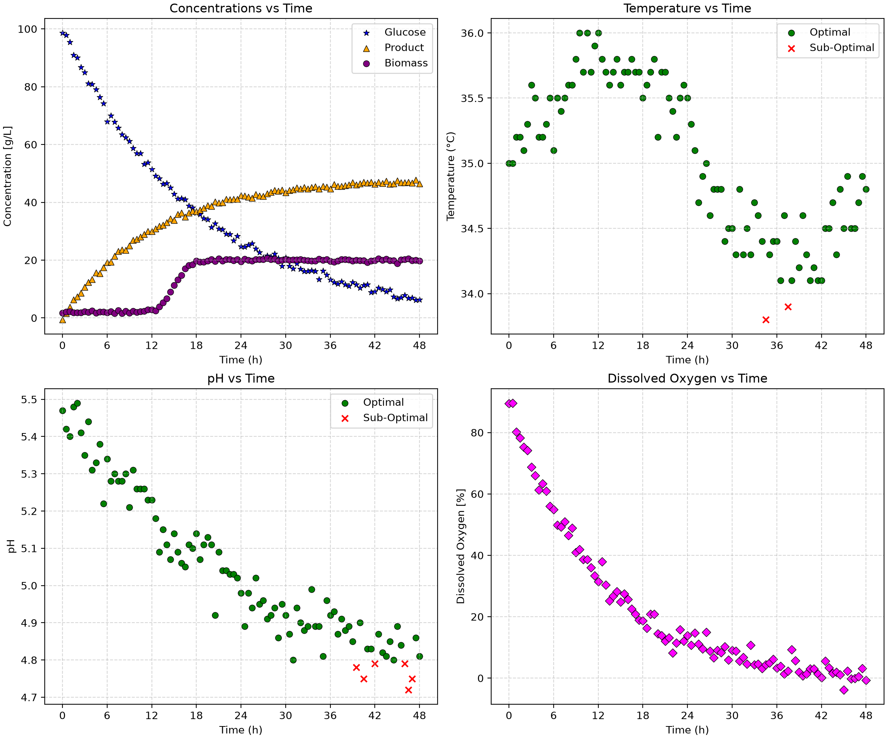

# Fermentation Bioprocess Monitor 
A Python-based bioprocess monitoring tool designed to automate batch data extraction of a fermentation process, while evaluating pH and temperature ranges, generating visual dashboards, and creating exportable CSV summaries.

## Overview
The goal of this project is to develop a tool to monitor a fermentation process using batch process data. The program analyzes individual fermentation batches, selects measurements that fall within the acceptable pH and temperature ranges, visualizes the process variables with 2x2 dashboard figures, and summarizes batch performance.

The project is designed to make it easier to identify operating conditions that may affect fermentation performance and to compare process conditions across different batches.

## Features
The BioprocessMonitor class provides the following: 
- Extracts data for individual fermentation batches.
- Identifies measurements within acceptable pH and temperature limits.
- Determines the number of unique batches in the dataset.
- Generates 2 × 2 dashboard figures for individual batches which:
  - Display glucose, biomass, and product concentrations over time.
  - Display temperature and pH measurements according to whether they are within the acceptable operating range.
  - Display dissolved oxygen throughout the fermentation.
- Generate summary tables containing the percentage of measurements within the acceptable pH and temperature ranges and the final product concentration for each batch.
- Exports dashboards as PNG files and summary tables as CSV files.
## Technologies Used
    - Python 3.11
    - pandas 3.0.6
    - matplotlib 3.11.2
## Code Design
The program is run through main.py, which uses the BioprocessMonitor class to analyze the fermentation data. The class is stored in src/classes.py and contains the methods used to extract batch data, check operating conditions, generate dashboards, and create summary tables.
When main.py runs, it analyzes the data using two different sets of acceptable pH and temperature limits, Mode A and Mode B. For each mode, the program goes through every batch in the dataset and checks which pH and temperature measurements fall within the specified limits.

A dashboard is then generated and saved for each batch using the figures/ directory. The visual dashboards show the concentrations of glucose, biomass, and product, as well as temperature, pH, and dissolved oxygen over time. The temperature and pH plots use different markers to distinguish measurements within and outside the acceptable ranges.

A summary table containing results for all batches in that mode is then saved as CSV files in the tables/ directory.
## Dashboard
The dashboard below shows the results for Batch 1 using Mode A operating limits. The top-left plot shows glucose, biomass, and product concentrations over time. The top-right plot shows temperature, while the bottom-left shows pH. Green circles indicate measurements within the acceptable operating range, while red X markers indicate measurements outside the range. The bottom-right plot shows dissolved oxygen over time.

## Summary Table
The summary table below shows the results for Mode A. It reports the percentage of measurements that were within the acceptable pH and temperature ranges for each batch, as well as the final product concentration.
The results show that most batches remained within the acceptable pH and temperature ranges of the fermentation process. Batch 5 had the lowest percentage of measurements within the acceptable pH range at 48.62% and also had the lowest final product concentration at 24.7 g/L. Batch 2 has the highest product concentration at 50.8 g/L with pH being 96.69% in the optimal range and temperature being 97.52% in the optimal range.

| batch_id | ph_optimal_percent | temperature_optimal_percent | C_product_g_L^-1_final |
|---:|---:|---:|---:|
| 1 | 93.81 | 97.94 | 46.5 |
| 2 | 96.69 | 97.52 | 50.8 |
| 3 | 95.89 | 93.15 | 44.6 |
| 4 | 100.0 | 96.47 | 48.6 |
| 5 | 48.62 | 99.08 | 24.7 |